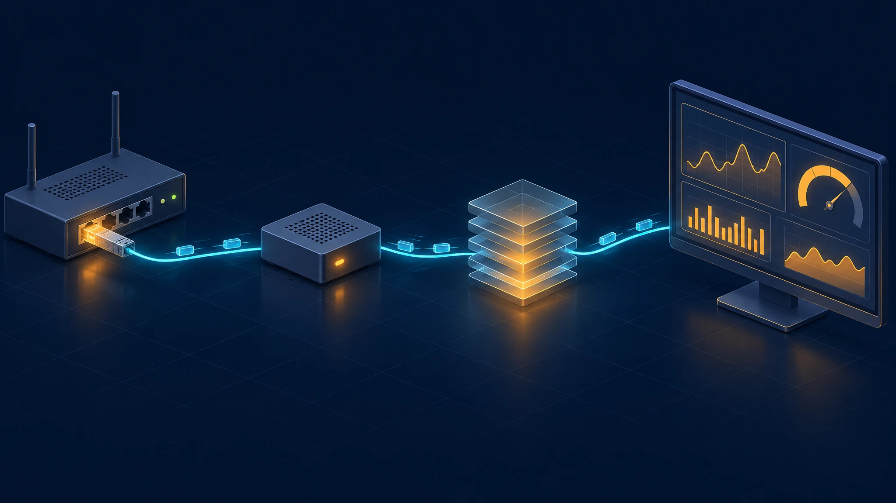
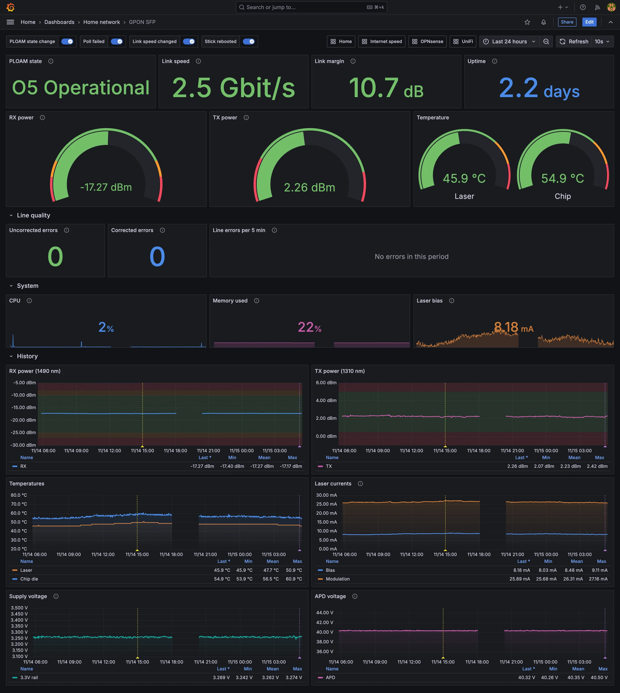

Last year I [ditched the PLDT modem]() and ran the fiber straight into a GPON SFP stick in my OPNsense box.

That setup has been rock solid ever since. But there was one thing that kept bugging me: I had no idea what the stick was actually doing.

The stick is a tiny Linux computer living inside an SFP cage. It talks to the ISP, holds the laser, and decides whether I have internet or not. And my only window into it was a web page I'd open maybe once a month.

So this wasn't about fixing anything again. I just wanted to *see* the link.

## What I Actually Wanted to Know

Not much, really. Just the things that would tell me if the fiber side is healthy before it becomes a problem:

- **Is it registered with the ISP?** (the PLOAM state, where O5 means "operational")
- **How strong is the signal?** RX power, and how much headroom I have before the link drops
- **Is the laser happy?** TX power, temperatures, bias current
- **Is the link to the router running at 2.5G?** (this one turned out to matter, more on that later)
- **Are there errors on the line?** Corrected and uncorrected

And ideally: history, so I can look back, and alerts, so I don't have to.

## The Stick Already Knows Everything

My stick is an Alcatel-Lucent **G-010S-P**, built on a Lantiq Falcon chip and running an OpenWrt-based firmware.

The nice surprise: the firmware ships with the vendor's own command-line tools. If you SSH in, you get:

- `onu` — the GPON driver's CLI (PLOAM state, link status, line error counters)
- `otop` — a status page with optical power, temperatures, laser currents and voltages

Everything I wanted was already there. It just wasn't being recorded anywhere.

## SSH vs. the Web API

The stick's web UI has a few JSON endpoints, so my first thought was to just poll those.

I tried it. Two problems showed up quickly:

- **It's heavy on the stick.** Every request means an HTTPS handshake and spinning up the Lua web framework on a single-core MIPS CPU. And under the hood it just runs the same `onu` and `otop` commands anyway.
- **The sessions expire.** It's a browser login, built for a person clicking around, not for something polling every few seconds.

SSH ended up being the better fit. One connection stays open, and each poll is just a handful of short commands. It also exposes more data than the web UI (the error counters aren't on there at all).

At a 10-second interval, polling costs the stick about **2% CPU**.

## Building the Exporter

The exporter itself is small. It keeps one SSH session to the stick, runs the commands every few seconds, parses the output, and serves it as Prometheus metrics.

From there it's the usual stack:

> GPON stick → exporter → Prometheus → Grafana

All of it runs in Docker on my homelab server, next to exporters for OPNsense and my other gear.

On the Grafana side I ended up with a dashboard that shows the essentials at a glance: PLOAM state, link speed, **link margin** (how far RX power sits above the receiver's sensitivity), gauges for RX/TX power and temperature, and history for everything else. Alerts cover the things I'd actually want to know about: the stick going unreachable, losing O5, the link falling back from 2.5G, margin getting thin, or errors piling up.

Most of the time it's a very boring dashboard: flat lines and green numbers. That's exactly what I want from it.

## Things I Learned Along the Way

### OPNsense updates can quietly undo the 2.5G fix

On the very first day, the dashboard caught the stick-to-router link dropping and coming back at **1G instead of 2.5G**. The fiber side was fine the whole time.

The cause was me: I was updating OPNsense, and the update replaced the patched Broadcom drivers that make 2.5G negotiation work (the same patch from the [original setup]()). Until I re-applied the patch, the link fell back to 1G. Once the drivers were patched again, it came back at 2.5G.

Without the "link speed" panel, I'd have just noticed "internet feels slower" and blamed the ISP. Now I know to check it after every OPNsense update.

### My signal has plenty of headroom

RX power sits around **-17 dBm**, which gives me roughly **11 dB of margin** before the receiver's sensitivity limit. That's comfortable. Good to know it's not just "working", it's working with room to spare.

### The weird details

- **Laser "age" isn't uptime.** `otop` reports it as days:hours:minutes, and it grows slower than uptime because the laser only transmits in bursts during its upstream time slots.
- **Load average sits around 1 even when idle.** Kernel threads waiting on hardware count towards it. The CPU itself is mostly asleep.
- **FEC counters stay at zero**, because my ISP doesn't enable forward error correction on the line.
- **The stick pretends to be the ISP's modem.** Digging through OMCI (the management protocol between the ISP and the ONU), it reports itself as the Huawei model the ISP normally hands out. That's how these sticks get accepted in the first place.

## Open-Sourcing It

Once it worked, it felt silly to keep it to myself. Plenty of people run these sticks, and most of them have the same blind spot.

So I cleaned it up and published it as **lantiq-onu-exporter**:

https://github.com/rashedobaid/lantiq-onu-exporter

A few things I made sure of before publishing:

- **It handles different firmware.** Other Lantiq Falcon sticks like the Nokia **G-010S-A** and Huawei **MA5671A** use different command names and sometimes a restricted shell. The exporter detects that on connect instead of assuming my setup.
- **It's tested against real output** captured from my stick, so changes for one stick don't quietly break another.
- **It's easy to run.** Copy `.env.example`, set the stick's IP, `docker compose up -d`.

I've only tested it on my G-010S-P so far. If you have a G-010S-A, MA5671A or another Falcon-based stick, I'd genuinely love to hear whether it works for you.

## Sources / Inspiration

Same as last time, hack-gpon was invaluable for understanding these sticks:

https://hack-gpon.org/

## Was It Worth It?

If your connection works and you never think about it, you don't need any of this.

But if you:
- already replaced your ISP modem with a GPON stick
- like knowing *why* something broke, not just *that* it broke
- run Prometheus and Grafana anyway

then it's a small addition that turns a black box into something you can actually see.

## Conclusion

The best part isn't the dashboard. It's that the next time my internet hiccups, I'll know in seconds whether it's the fiber, the stick, the router, or the ISP.

And it already paid off once, catching a 1G fallback after an OPNsense update that I'd otherwise have blamed on PLDT.

Would I build it again? Definitely. And this time, anyone else with one of these sticks gets it for free.
